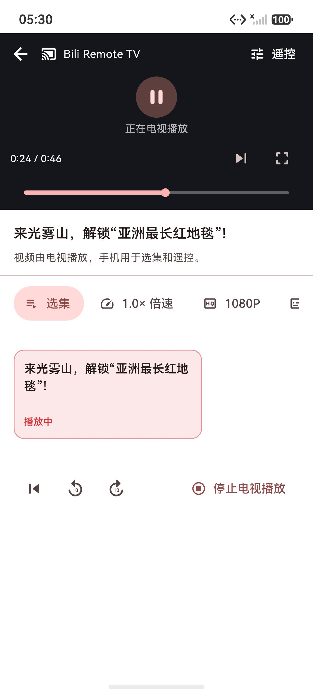
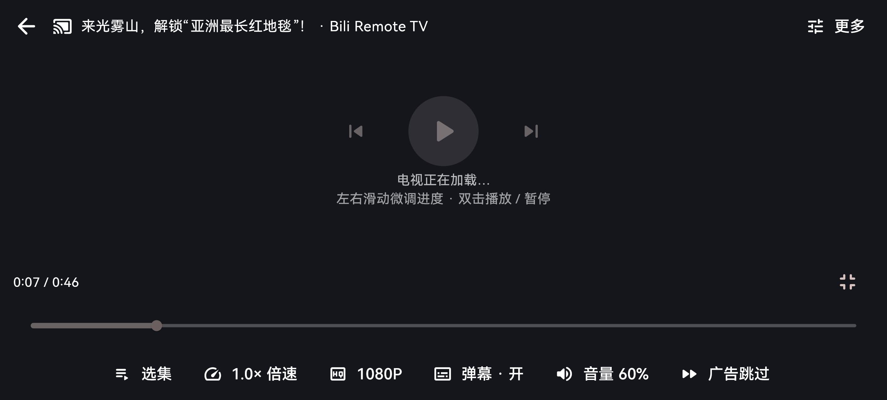
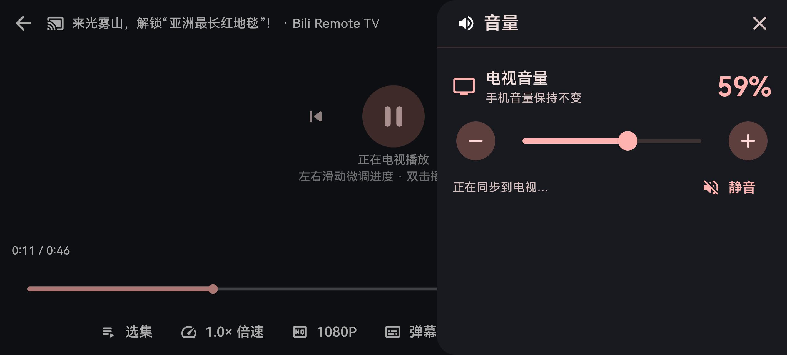

<p align="center"></p>
<h1 align="center">跃映 · Yueying</h1>
<p align="center">手机选视频，电视独立播放。支持 Android 手机、HarmonyOS 手机与 Android TV。</p>
<p align="center"> </p>
<p align="center">
  <a href="docs/setup.md">安装与搭建</a> · <a href="docs/ai-setup.md">交给 AI 搭建</a> · <a href="docs/harmonyos-release.md">鸿蒙邀测准备</a> · <a href="https://github.com/Dcelysia/yueying/releases">构建与发行</a>
</p>

跃映是基于开源项目二次开发的家庭视频浏览与电视控制客户端。手机发送所选视频编号和控制命令，电视使用自己的 B站登录态获取视频、播放弹幕；视频流直接到电视，手机不镜像屏幕，也不中转媒体流。

**上游权益与项目身份：** Android 手机基于 [PiliPlus](https://github.com/bggRGjQaUbCoE/PiliPlus)（[GPL-3.0](apps/mobile/LICENSE)），电视基于 [NeoBV](https://github.com/b1ackmarket/NeoBV)（[MIT](apps/tv/LICENSE)）。**dcelysia 是本改版维护者，并非全部原始代码的作者。** 原版权头、署名、LICENSE 与 AUTHORS 均保留；其他组件适用各自许可证，见[开源说明](ohos-poc/assets/legal/NOTICE.md)和[固定来源记录](sources.lock.json)。本项目独立开发，与哔哩哔哩官方无关，开源许可不授予其内容、接口或商标授权。

当前处于家庭测试预览阶段。鸿蒙侧尚不表示已通过华为审核或正式上架；安装包与测试状态以实际发布记录为准。

## 一套电视状态，多部手机接力

| 端 | 浏览、选视频 | 手机本地播放 | 电视控制 |
| --- | --- | --- | --- |
| Android 手机 | 保留 PiliPlus 浏览与账号功能 | 保留 | 支持 |
| HarmonyOS 手机 | 推荐、热门、搜索、详情、分 P、收藏与历史 | 不包含 | 支持，占位播放器与全屏控制 |
| Android TV / 电视盒子 | 保留 NeoBV 电视界面 | 在电视播放 | 接收多个手机的操作并回传状态 |

- 手机 A 开始播放后，手机 B 连接同一电视，可进入现有占位播放器查看当前视频、进度和控制项；进入页面不会重播或重置进度。
- A 切换视频、选集或进度，B 跟随电视状态同步；多手机控制以电视接收端状态为准。
- 支持暂停、进度、选集、音量、倍速、画质、弹幕与赞助片段跳过。具体画质、分集和可跳过片段取决于视频及电视端返回的能力。
- 手机退出页面、锁屏或断开连接，不会停止电视。主动点击“停止电视播放”才发送停止命令。

## 真实界面

以下为 2026-10-24 开发预览版的模拟器实拍，未重绘软件界面；后续构建可能调整样式。画面中的 `Bili Remote TV` 是电视接收端名称。

<p align="center"></p>

| 鸿蒙全屏占位播放器 | 电视音量面板 |
| --- | --- |
|  |  |

### 产品操作演示

下面的自动预览节选了真实产品操作；完整视频约 52 秒，可直接在 GitHub 页面内点播。


https://github.com/user-attachments/assets/0801407f-f1e5-4945-9c4e-27a20b772261

演示展示 B 从首页进入电视已有播放、A 切片后 B 标题同步，以及 B 全屏调节音量、进度和播放状态。每个片段的手机与电视来自同一录制时段；已剪去等待，A 画面未录制，没有合成 UI 或运动补帧。不是帧率、延迟或零掉帧证明。来源与采集边界见[素材说明](docs/images/README.md)及[视频说明](docs/videos/README.md)。

## 开始使用

1. 在 Android 电视或盒子安装本项目电视 APK并打开；在手机安装对应版本客户端。两端连接同一家庭局域网。
2. 手机上打开“连接电视”，选择自动发现的电视。找不到时，可输入电视实际 IP 和控制端口 `9838`。
3. 手机选视频交给电视播放，或连接后直接进入电视已有播放的占位控制页。手机与电视可分别登录自己的 B站账号。

不需要刷机或 root。ADB 仅用于开发安装或可选系统授权，不是日常手机遥控的通信协议。电视开发者选项、ADB 调试和电脑信任须由使用者在设备上手动开启、确认。详细步骤见[安装与搭建](docs/setup.md)。

## 从源码构建

```sh
git clone https://github.com/Dcelysia/yueying.git
cd yueying
python3 scripts/setup-flutter.py
python3 scripts/build-apks.py --only mobile
python3 scripts/build-apks.py --only tv --tv-build-type release
```

Android 构建需要 Python 3.11+、Android SDK 和 JDK 17；仓库固定 Flutter 3.47.7 / Dart 3.13.5，包含 PiliPlus 配套补丁。鸿蒙单独使用 Flutter-OH，不替换 Android 的 SDK。环境、签名、模拟器和鸿蒙发布包步骤见[完整搭建说明](docs/setup.md)及[鸿蒙端说明](ohos-poc/README.md)。

| 目录 | 内容 |
| --- | --- |
| `apps/mobile` | PiliPlus 派生 Android 手机端 |
| `ohos-poc` | 跃映鸿蒙浏览与电视控制端，GPL-3.0 |
| `packages/bili_remote_core` | Android / HarmonyOS 共享发现、协议和播放状态，GPL-3.0 |
| `apps/tv` | NeoBV 派生电视接收端及遥控服务，MIT |
| `apps/tv/akdanmaku` | 固定版本 AkDanmaku 弹幕依赖及其原许可证 |
| `apps/tv/libs` | 固定原生解码依赖及来源说明 |
| `third_party/material_ui` | PiliPlus 配套 Material UI 与原许可证 |
| `scripts`、`docs` | 构建工具、[协议](docs/protocol.md)、安装和发布说明 |

## 源码与许可证

| 来源 / 组件 | 许可与归属 |
| --- | --- |
| PiliPlus、派生手机代码、共享遥控与鸿蒙端 | GPL-3.0，保留原作者与本改版的许可义务 |
| NeoBV 电视代码 | MIT；第三方播放器与依赖仍适用各自许可 |
| AkDanmaku | MIT；其 LICENSE 同时列出 libGDX 等依赖条款 |
| Flutter / Material UI、Hive CE、connectivity_plus、crypto、qr 系列 | 对应组件 BSD 类许可，具体见原文本 |
| GetX | MIT |

本地开发仓库通过未 squash 的 Git subtree 保留 PiliPlus、NeoBV 和 bv-libs 上游历史；公开仓库以当前完整源码的独立安全快照发布，不携带本地或上游旧历史对象。原开发仓库及其历史仍保留，上游固定 SHA 记录在 `sources.lock.json`。

分发本改版时，应提供与实际二进制对应的完整源码、本项目修改、构建说明及许可证；不能只指向上游仓库。[鸿蒙预览版对应源码](https://github.com/Dcelysia/yueying/tree/harmony-v1.0.0-preview.1)。第三方原生依赖的准确来源见 [`apps/tv/libs/README.md`](apps/tv/libs/README.md)，完整版本由相应锁定文件记录。

biliMusic 为手机与电视协作方式提供了设计启发，未复制其业务代码。项目功能及可访问内容仍受第三方服务、账号权限、网络与设备能力影响。

维护者：**dcelysia**。[隐私政策](https://dcelysia.github.io/yueying/site/privacy.html) · [用户协议](https://dcelysia.github.io/yueying/site/terms.html)。
